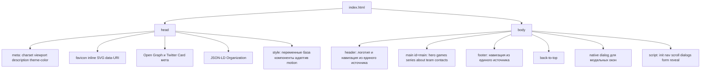

# Архитектурный план оптимизации — ENTDEV Interactive (Cite/index.html)

## 1. Контекст и ограничения

- **Проект:** лендинг инди-студии ENTDEV Interactive, единственный файл `Cite/index.html` (1394 строки: ~880 CSS, ~350 HTML, ~160 JS).
- **Жёсткое ограничение:** строго ОДИН файл `index.html` — разделение на style.css/script.js и внешние ассеты недопустимо. Всё оформление и логика остаются inline; медиа — только CSS-градиенты / inline SVG / data-URI.
- **Форма:** демо-режим — реальной отправки нет, но валидация должна быть корректной и доступной (ARIA, живой регион, сброс ошибок при вводе).
- **Цель:** устранить критические дефекты доступности и корректности, навести порядок в архитектуре внутри одного файла, добавить SEO-метаданные и полировку производительности.

## 2. Целевая архитектура файла

## 3. Категории проблем и целевые решения

| # | Проблема (текущее состояние) | Решение | Приоритет |
|---|------------------------------|---------|-----------|
| 1 | Контент невидим без JS: `.reveal { opacity: 0 }` | Класс `js` на `<html>` добавляется скриптом в начале; скрытие применять только через `.js .reveal` — без JS всё видно | Критично |
| 2 | Форма не отправляет данные и игнорирует a11y | Демо-отправка с состояниями (загрузка/успех/ошибка), `aria-invalid`, `aria-describedby`, `role="alert"` для ошибок, `aria-live` регион для успеха, сброс ошибок по `input` | Критично |
| 3 | Модалки без фокус-ловушки, Esc-обработки, блокировки фона | Замена на нативный `<dialog>` + `showModal()`: фокус, Esc, `::backdrop`, верхний слой из коробки; слушать `close`/`cancel` | Критично |
| 4 | Нет видимых фокус-стилей у `.hamburger` и `.modal-close` (глобальный `outline: none`) | Добавить `:focus-visible` для всех интерактивных элементов; сузить сброс outline | Критично |
| 5 | Мёртвые ссылки соцсетей `href="#"` | Заменить на реальные/платформенные URL (YouTube и т.п.); при отсутствии аккаунтов — целевые страницы платформ | Высокий |
| 6 | Недействительный `mailto:hello@entdev.interactive` (несуществующая TLD) | Поменять на реальный/корректный адрес (пример: `hello@entdev.ru`) | Высокий |
| 7 | Хрупкий `section:nth-child(even)` для фонов | Явные классы-модификаторы (`section--alt` или класс `bg-main`) на секциях | Высокий |
| 8 | Тройное дублирование навигации (десктоп/мобайл/футер) | Единый массив ссылок в JS, генерация трёх меню, `<noscript>`-фолбэк со статическим меню | Высокий |
| 9 | Inline-стили в разметке (5 мест) | Замена на утилитарные классы (`.series-grid`, `.modal-genre` и т.п.) | Высокий |
| 10 | Конфликт CSS-smooth-scroll и JS-скролла + хардкод 64px | `scroll-padding-top: var(--header-h)` в CSS, удалить JS-скролл и вычитание 64px | Средний |
| 11 | Два неоптимизированных scroll-обработчика; `pageYOffset` | Один обработчик на `scroll` с `requestAnimationFrame`-троттлингом: scrollspy + back-to-top; заменить на `scrollY` | Средний |
| 12 | Scanline-оверлей z-index 9998 перекрывает модалки | Модалки на `<dialog>` автоматически попадают в верхний слой — проблема уходит; z-index оверлея снизить до 900 | Средний |
| 13 | `backdrop-filter` без префикса и фолбэка | `-webkit-backdrop-filter` + `@supports` | Средний |
| 14 | `.hero { min-height: 100vh }` ломается на мобильных | `100svh` внутри `@supports` с фолбэком на `100vh` | Средний |
| 15 | Дублирование цветов хардкодом при наличии переменных | Вынести в переменные: аватары, hover-оттенки, `#0d0d0d` → `--bg-solid` и т.д. | Средний |
| 16 | `--text-muted: #6b6b6b` — контраст ~3.9:1, не проходит WCAG AA | Повысить до `#8a8a8a` (≈5.9:1) | Средний |
| 17 | Скачок полосы прокрутки при `body { overflow: hidden }` | `html { scrollbar-gutter: stable }` + блокировка скролла через события `dialog open/close` | Средний |
| 18 | Нет skip-link для клавиатурной навигации | Ссылка «К содержимому» → `#main` | Средний |
| 19 | Анимация `.nav-mobile` не работает на закрытие (`display: none`) | Переход через `visibility` + `transform` | Средний |
| 20 | Нет favicon, theme-color, Open Graph, JSON-LD | Inline SVG favicon (data-URI), `theme-color`, OG/Twitter мета, JSON-LD `Organization` | Средний |
| 21 | Мёртвый CSS (`image-rendering: pixelated` без изображений) | Удалить либо оставить только там, где реально есть графика | Низкий |
| 22 | Устаревший синтаксис JS (var, ES5-паттерны, повторные обходы DOM) | Современный синтаксис (const/let, стрелки), делегирование событий, кеширование DOM-ссылок, нормализованные комментарии-секции | Низкий |
| 23 | Секции `hero`/`games`/... без явной связи с навигацией | JS-генерация навигации создаёт и фолбэк, и ссылки из одного массива; `data-section` сохраняется для scrollspy | Низкий |

## 4. Фазы реализации

### Фаза 1 — Корректность и доступность (критическое)
1. Прогрессивное улучшение: класс `js` на `<html>`; CSS-правила `.reveal` переписать на `.js .reveal`.
2. Модальные окна: заменить `.modal-overlay` div'ы на `<dialog>` (2 шт.) с `showModal()`, `close()` и событиями `close`/`cancel`; удалить ручной Escape-обработчик и `body.style.overflow`.
3. Skip-link «Перейти к содержимому» + `id="main"` на `<main>`.
4. Форма: `aria-invalid`, `aria-describedby`, `role="alert"` на ошибках, `aria-live="polite"` на успехе, сброс ошибок по `input`, состояния демо-отправки (disabled-кнопка + задержка + успех).
5. Focus-стили: `:focus-visible` для `.hamburger`, `.modal-close`, `.nav-link`, `.social-link`, `.tool-tag`.
6. Контраст: `--text-muted` → `#8a8a8a`.
7. Секции: убрать `section:nth-child(even)`, добавить явный класс чередования фона.
8. Ссылки: реальные URL соцсетей, корректный `mailto`.

### Фаза 2 — Архитектура кода внутри файла
9. Единый источник навигации: массив `{id, label}` → генерация десктоп-, мобильного и footer-меню; `<noscript>`-фолбэк.
10. Скролл: `scroll-padding-top: var(--header-h)` + `scroll-behavior: smooth` в CSS; удалить JS-перехват якорей.
11. Один rAF-троттлинг для scrollspy + back-to-top; `scrollY` вместо `pageYOffset`.
12. Переменные: вынести все дублирующиеся цвета; удалить мёртвый CSS.
13. Inline-стили → утилитарные классы.
14. `100svh` для `.hero`; `-webkit-backdrop-filter` + `@supports`; `scrollbar-gutter: stable`.
15. `.nav-mobile` закрытие через `visibility+transform`; z-index scanline → 900.
16. JS: современный синтаксис, делегирование, кеширование селекторов, секции-комментарии.

### Фаза 3 — SEO и финальная полировка
17. Favicon (inline SVG data-URI), `theme-color`, Open Graph/Twitter Card мета, JSON-LD Organization.
18. Финальное ревью структуры файла (head → body → script), нормализация комментариев.
19. Проверка: рендер без JS; клавиатура (Tab, Esc, фокус, skip-link); мобильная вёрстка 375px; `prefers-reduced-motion`.

## 5. Критерии приёмки

- Страница полностью читаема и функциональна при отключённом JS (меню-фолбэк, видимый контент).
- Модальные окна открываются с фокусом внутри, закрываются по Esc и клику вне; фокус возвращается на кнопку.
- Форма: ошибки с `aria-invalid`/`aria-describedby`, успех озвучивается `aria-live`; ошибки исчезают при вводе.
- Вся навигация генерируется из одного массива; добавление пункта меню — одна правка.
- Нет inline-стилей в разметке (допустимы только data-URI favicon).
- Цвета — только через CSS-переменные; контраст muted-текста ≥ 4.5:1.
- Файл валиден: один `h1`, одна `<main>`, корректные id секций и якоря.